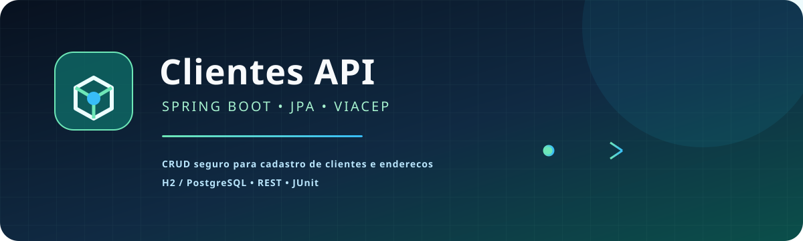

<p align="center">
  
</p>

# Clientes API

API REST Spring Boot para cadastro de clientes. O endereço é preenchido consultando o ViaCEP a partir do CEP informado. O projeto usa uma separação simples entre API, serviço, persistência e integração externa, com respostas de erro sem dados internos.

## Requisitos

- Java 21+
- Maven 3.9+

## Executar

```bash
mvn spring-boot:run
```

Executar testes:

```bash
mvn test
```

O banco padrão é H2 em memória. Para PostgreSQL, substitua `spring.datasource.*` por variáveis de ambiente em uma configuração externa.

## Exemplos

```bash
curl -X POST http://localhost:8080/api/customers \
  -H 'Content-Type: application/json' \
  -d '{"name":"Ana Silva","email":"ana@example.com","cep":"01001-000"}'
curl http://localhost:8080/api/customers
```

Endpoints: `GET /api/customers`, `GET /api/customers/{id}`, `POST`, `PUT /api/customers/{id}` e `DELETE /api/customers/{id}`.
